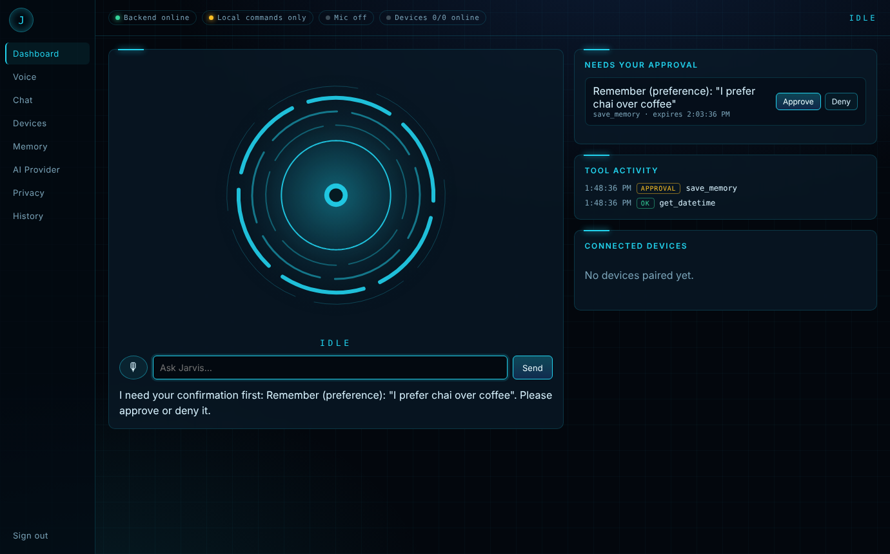

# JARVIS Ultimate AI

A personal assistant inspired by JARVIS: one backend brain, a web console, a Windows desktop
app, and an Android app — with voice, memory you control, web search, and permission-gated
device automation across phone and PC.

> **Status:** the backend, web console, Windows agent and cross-device flow are tested (90 automated
> tests). **GitHub Actions builds the Android APK and the Windows EXE on every push** — download them
> from the [Releases](../../releases) page or the latest [Actions](../../actions) run. The APK and EXE
> are built and their unit/smoke tests pass on CI, but they have **not yet been tried on a real phone
> or PC with a microphone**. See [`docs/STATUS.md`](docs/STATUS.md) for exactly what is verified.

[](../../actions/workflows/ci.yml)
[](../../actions/workflows/android.yml)
[](../../actions/workflows/windows.yml)

## Download
- **Android:** `JarvisUltimate-debug.apk` from Releases/Actions → install (allow "unknown sources") → tap **Start Jarvis on this phone**. Works without any server (phone-only mode); add your own AI key in *More → AI Provider* for full conversations.
- **Windows:** `JarvisDesktop-windows.zip` from Releases → unzip → `JarvisDesktop.exe`.
- **Backend:** runs on any PC/server with Python (see Quick start). Both apps connect to it.

```
jarvis-ultimate/
├── backend/          Python (Starlette + Pydantic) API, AI providers, tools, memory, devices + web console
│   ├── jarvis/       application package (migrations/, providers/, tools/, static/)
│   └── tests/        68 backend tests
├── desktop/          Windows assistant: PySide6 UI + sandboxed device agent (allowlist)
│   └── tests/        19 tests (tools, path safety, agent, voice, credentials)
├── android/          Kotlin + Jetpack Compose app (SpeechRecognizer, TTS, Room, intents)
├── shared/           tool_catalog.json (generated) + API contract samples
├── tests/            end-to-end test: real server + real desktop agent
├── docs/             ARCHITECTURE, SECURITY, STATUS, ANDROID, WINDOWS, API
└── .env.example
```



## How it fits together

```
 Android app ──┐                        ┌──> AI provider (Anthropic / OpenAI-compatible / Ollama / none)
 Web console ──┼── HTTPS ──> Backend ───┼──> Search API (Brave / Tavily)
 Desktop app ──┘   (auth)    SQLite     └──> task queue ──> paired phone / PC poll it (outbound only)
```

Every action the AI wants to take goes through one tool framework: validated arguments → your
permission switches → confirmation for sensitive actions (only *you* can approve) → executed on
the server or queued for an approved device → audited. Devices never open a port.

## Quick start (backend + web console) — ~2 minutes

Requires Python 3.11+.

```bash
cd jarvis-ultimate/backend
python -m venv .venv
# Windows: .venv\Scripts\activate      macOS/Linux: source .venv/bin/activate
pip install -r requirements-dev.txt
cp ../.env.example .env                  # Windows: copy ..\.env.example .env
python -c "import secrets; print(secrets.token_urlsafe(48))"   # paste into JARVIS_SECRET_KEY in .env
python -m pytest -q                      # 68 tests
python -m jarvis --port 8765             # http://127.0.0.1:8765
```

Open http://127.0.0.1:8765, create the owner account, and try:
*"Hey Jarvis, how are you?"*, *"what time is it"*, *"remember that I prefer chai over coffee"*
(then approve it), *"search the web for …"* (needs a search key).

Without an AI key the assistant runs in **local command mode** (a pattern matcher, clearly labelled
in the UI). For real conversations set a provider in `.env`, for example:

```ini
# Claude
JARVIS_LLM_PROVIDER=anthropic
JARVIS_LLM_MODEL=<current Claude model id from docs.claude.com>
JARVIS_LLM_API_KEY=sk-ant-...

# or free & local with Ollama (ollama pull <model>)
JARVIS_LLM_PROVIDER=openai-compatible
JARVIS_LLM_BASE_URL=http://localhost:11434/v1
JARVIS_LLM_MODEL=<model you pulled>
```

Voice in the web console uses the browser's speech engine (Chrome/Edge for recognition).

## Windows desktop app

```powershell
cd jarvis-ultimate\desktop
python -m venv .venv; .venv\Scripts\activate
pip install -r requirements-dev.txt
python -m pytest -q                                       # 19 tests
copy allowlist.example.json $env:APPDATA\JarvisDesktop\allowlist.json   # then edit it
python -m jarvis_desktop                                  # GUI
# or headless:
python -m jarvis_desktop pair --backend https://your-backend --code ABCD-EFGH
python -m jarvis_desktop agent
pyinstaller jarvis_desktop.spec                           # -> dist\JarvisDesktop\JarvisDesktop.exe
```

Details: [`docs/WINDOWS.md`](docs/WINDOWS.md).

## Android app

Open `android/` in Android Studio (Ladybug or newer, JDK 17+) and Run, or:

```bash
cd jarvis-ultimate/android
./gradlew assembleDebug        # -> app/build/outputs/apk/debug/app-debug.apk
./gradlew testDebugUnitTest
```

On the emulator use backend URL `http://10.0.2.2:8765`. On a real phone use HTTPS (see
[`docs/ANDROID.md`](docs/ANDROID.md), including microphone/battery/background limits).

## Connecting phone and PC

1. Run the backend somewhere both devices can reach **over HTTPS** — simplest is
   [Tailscale](https://tailscale.com) (`tailscale serve 8765`) so nothing is exposed publicly.
2. Phone: sign in → Devices → *Let Jarvis control this phone*.
3. PC: Devices → *Pairing code for a computer* on the phone/web → enter it in Jarvis Desktop
   → approve the computer on the phone.
4. Say *"open notepad on my computer"* to your phone.

## Running everything's tests

```bash
cd jarvis-ultimate
pip install -r backend/requirements-dev.txt -r desktop/requirements.txt
python -m pytest -q backend/tests desktop/tests tests      # 89 tests (+1 GUI test that runs where PySide6 is installed)
```

## Documentation

- [Architecture & trade-offs](docs/ARCHITECTURE.md)
- [Security & privacy](docs/SECURITY.md)
- [What's done / not done, and how it was verified](docs/STATUS.md)
- [API reference & provider configuration](docs/API.md)
- [Windows](docs/WINDOWS.md) · [Android](docs/ANDROID.md)
